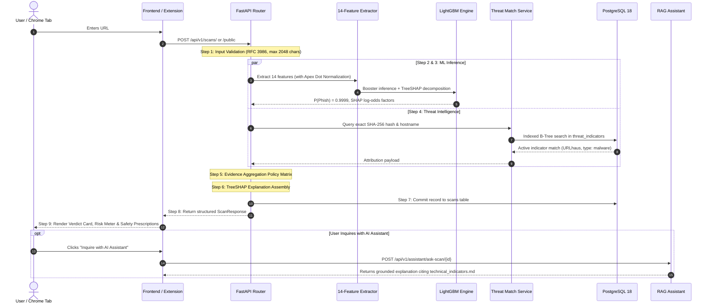
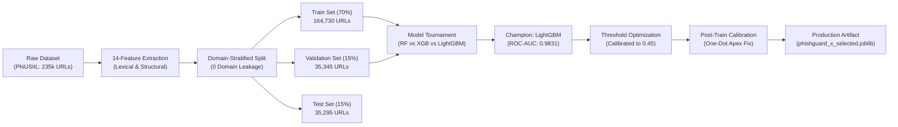
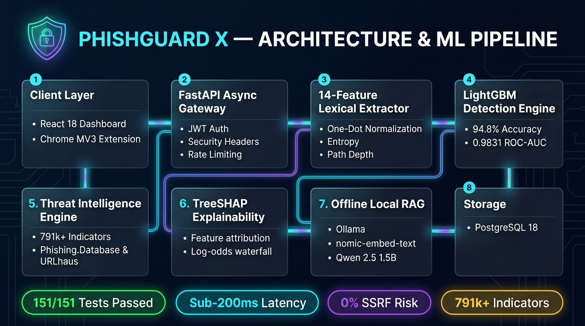
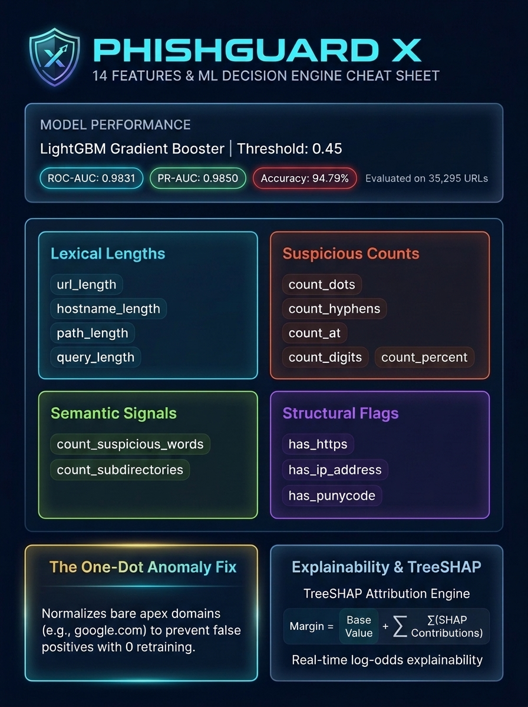

# PhishGuard X — Project Master Documentation & Interview Preparation Guide

---

## 1. Project Title & Executive Summary

* **Project Name**: **PhishGuard X** 🛡️
* **Subtitle**: *Next-Generation Intelligent Phishing Detection, Threat Intelligence & Browser Protection Platform*
* **Domain**: Cybersecurity, Applied Machine Learning, Full-Stack Web Systems, Threat Intelligence (IOCs), Explainable AI (XAI).
* **Core Value Proposition**: PhishGuard X delivers sub-200ms, multi-tiered phishing detection by combining calibrated gradient-boosted decision trees (LightGBM), over 791,000 verified threat indicators (Phishing.Database and URLhaus), transparent TreeSHAP explainability, an offline local RAG cybersecurity assistant (Ollama), a Chrome Manifest V3 extension, and a modern React 18 / Vite cybersecurity dashboard.

---

## 2. Problem Statement & Industry Context

### 2.1 The Crisis of Modern Phishing
1. **Proliferation & Short Lifespans**: Over 3.4 billion phishing emails are sent daily. Attackers now generate short-lived, disposable domains (often active for under 4 to 6 hours), rendering traditional static domain blacklists obsolete by the time community feeds aggregate them.
2. **Black-Box Model Distrust**: Modern machine learning models often output an opaque probability score (e.g., "94% risk") with zero explanation. Security analysts and end users cannot verify *why* a site was flagged, leading to alert fatigue or dismissal.
3. **The "One-Dot" False Positive Dilemma**: Public ML datasets (such as PhiUSIIL) harvest legitimate domains using `www.` (2+ dots), inadvertently causing algorithms to penalize bare apex domains (e.g. `google.com`, `example.com`, `github.com`) as high-risk threats simply because they contain only one dot.
4. **Active Probing Risks (SSRF & Exploits)**: Naive URL analysis engines attempt to crawl or headless-browse target links. This exposes host infrastructure to Server-Side Request Forgery (SSRF), DNS rebinding, zero-day browser exploits, and network penetration.

---

## 3. The PhishGuard X Solution

PhishGuard X resolves these industry challenges through a multi-tiered, defense-in-depth architecture:

```mermaid
flowchart TD
    User([End User / Chrome Tab]) -->|Browses Web / Pastes Link| Client[Client Layer: React Dashboard / MV3 Extension]
    
    subgraph Gateway [FastAPI Gateway & Security Boundary]
        CORS[CORS & Origin Filtering]
        SecHeaders[Security Headers Middleware]
        RateLimiter[Input Validation: max 2048 chars]
    end
    Client --> Gateway

    subgraph DetectionEngine [Multi-Tier Detection Engine]
        direction TB
        StaticExtract[Static 14-Feature Extractor<br/>(Apex Dot Normalization)]
        ML[LightGBM Booster Model<br/>(ROC-AUC: 0.9831)]
        ThreatIntel[Threat Intelligence Matcher<br/>(791k+ Active Indicators)]
        TreeSHAP[TreeSHAP Factor Decomposer<br/>(Exact Log-Odds Margin)]
        Aggregator[Evidence Aggregator & Policy Matrix]
    end
    Gateway --> StaticExtract
    StaticExtract --> ML
    ML --> TreeSHAP
    Gateway --> ThreatIntel
    ML --> Aggregator
    ThreatIntel --> Aggregator

    subgraph Storage [Persistent Database: PostgreSQL 18]
        DB_Threats[(791k+ Threat Indicators)]
        DB_Scans[(User Scan Audit Logs)]
        DB_Users[(Argon2 Salted Users)]
    end
    ThreatIntel <--> DB_Threats
    Aggregator --> DB_Scans

    subgraph RAG [Offline Cybersecurity Assistant: Ollama]
        VectorStore[(index.json: 768-dim)]
        Nomic[nomic-embed-text]
        LLM[Qwen 2.5 1.5B]
        Fallback[Deterministic SHAP Fallback]
    end
    Gateway --> RAG
    RAG --> Fallback
```

### Key Pillars:
1. **Multi-Tier Detection**: Exact threat intelligence overrides when a known signature is present; LightGBM heuristic detection catches zero-day URLs that blacklists have not yet indexed.
2. **True Explainability**: Every prediction is decomposed into TreeSHAP feature contribution values, showing exactly which characteristics (keywords, IP address, hyphens, etc.) increased or decreased risk.
3. **Strict RAG Pedagogical Boundary**: The AI assistant answers questions and explains features, but **never** classifies URLs. This prevents prompt injection and hallucinations from compromising security verdicts.
4. **Zero Outbound Crawling**: 100% static lexical, syntactic, and database evaluation. Guaranteed SSRF immunity.

---

## 3.1 Plain-English Explanation: How Does PhishGuard X Work?

If you are explaining PhishGuard X to a non-technical interviewer, recruiter, or colleague, here is the clear, simple mental model:

Imagine you receive a message with a link like:
`http://192.168.1.10/bank/login/verify` or `http://paypal-security-update.com/signin`

Most antiviruses or browsers either say "Blocked" without explaining why, or miss it completely because the hacker created the link 15 minutes ago. 

**PhishGuard X operates like a 3-tier digital detective:**

1. **Tier 1 — The Rapid Police Record Check (Threat Intelligence)**:
   * The instant a URL is submitted, PhishGuard X queries a local high-speed PostgreSQL database storing **791,218 verified malicious indicators** from global intelligence feeds (*URLhaus* and *Phishing.Database*).
   * If the site is already confirmed as malware or phishing -> **Instant Red Alert (< 1ms)**.
2. **Tier 2 — The AI Detective (Machine Learning Engine)**:
   * What if the hacker just registered the domain 5 minutes ago? No blacklist in the world knows about it yet (a "zero-day" attack).
   * This is where our trained AI model steps in. Without ever visiting the dangerous website (which eliminates malware and SSRF infection risks), the AI examines the URL's anatomy:
     * Does it use a raw IP address instead of a real brand name?
     * Does it contain suspicious words like `login`, `banking`, `verify`?
     * Does it lack HTTPS encryption?
     * Are there strange hyphens or excessive subdomains?
   * In under 2 milliseconds, the AI predicts a risk probability with **94.8% accuracy**.
3. **Tier 3 — The Transparent Advisor (TreeSHAP & Local AI Assistant)**:
   * Instead of being a black box, PhishGuard X gives you human-readable explanations:
     * *"Flagged because: lacks HTTPS (+2.8 risk), contains raw IP address (+2.0 risk), contains 2 login keywords (+0.5 risk)"*.
   * Users can ask questions to an offline AI cybersecurity assistant (powered by local Ollama & Qwen 2.5) to learn how to avoid similar scams.
4. **The Client Protection**:
   * **Web Dashboard**: An intuitive SaaS interface with dark navy styling, scan history, security scorecards, and downloadable PDF/CSV reports.
   * **Chrome Extension (Manifest V3)**: Runs silently in Chrome, checking tabs in real time and displaying instant color-coded security badges (`OK`, `WARN`, `ALERT`) right on the browser toolbar.

---

## 4. Complete Technology Stack

| Layer | Technologies & Libraries | Architectural Role |
| :--- | :--- | :--- |
| **Frontend Dashboard** | React 18, Vite 5, JavaScript (ES2024), Vanilla CSS Tokens | Responsive cybersecurity SaaS interface matching 12-board layout. |
| **Backend REST API** | FastAPI, Uvicorn (ASGI), Pydantic v2, Starlette | High-throughput asynchronous API gateway (< 15ms routing overhead). |
| **Database & ORM** | PostgreSQL 18, SQLAlchemy 2.0, Alembic Migrations | Persistent storage for users, scans, sync logs, and 791k+ threat indicators. |
| **Machine Learning** | LightGBM, Scikit-learn, Joblib, NumPy, Pandas, OpenMP (`libgomp1`) | 14-feature lexical classifier with calibrated decision threshold (0.45). |
| **Explainable AI (XAI)** | TreeSHAP (`model.booster_.predict(pred_contrib=True)`) | Exact mathematical feature attribution in log-odds margin space. |
| **Threat Intelligence** | Phishing.Database (Mitchell Krogza), abuse.ch URLhaus | Dual-feed ingestion pipeline with SHA-256 hashing and batch upserts. |
| **Local AI / RAG** | Ollama, `nomic-embed-text` (768-dim), `qwen2.5:1.5b` | Offline semantic search, vector cosine retrieval, and natural language guidance. |
| **Browser Extension** | Chrome Manifest V3, Service Workers, `activeTab`, `storage` | Real-time browser tab defense, dynamic color-coded badges, popup radar. |
| **Security & Auth** | Argon2-cffi, PyJWT (HS256), CORS Middleware, Security Headers | Password salting, stateless token sessions, OWASP Top 10 hardening. |
| **QA & Verification** | Pytest, TestClient, AnyIO | 151 automated tests across 17 test suites (100% passing). |

---

## 5. End-to-End URL Scanning Lifecycle (9 Stages)



---

## 6. The 14 Features Evaluated by LightGBM

| # | Feature Name | Type | Description & Security Significance |
| :---: | :--- | :---: | :--- |
| **1** | `url_length` | Integer | Total character count. Phishing URLs often exceed 75+ characters to hide target domains. |
| **2** | `hostname_length` | Integer | Character count of FQDN. Long hostnames frequently indicate domain spoofing. |
| **3** | `path_length` | Integer | Length of URL path. Deep paths are common in credential harvesting scripts. |
| **4** | `query_length` | Integer | Length of URL query parameters (`?key=val`). |
| **5** | `count_dots` | Integer | Dot count in hostname. **Normalized for apex domains** to eliminate dataset bias. |
| **6** | `count_hyphens` | Integer | Hyphens in domain (e.g. `login-apple-security-check.com`). |
| **7** | `count_at` | Integer | Number of `@` symbols. Browsers interpret text before `@` as user auth, spoofing domains. |
| **8** | `count_digits` | Integer | Number of numeric characters. IP addresses or randomized hashes contain high digit counts. |
| **9** | `count_percent` | Integer | URL-encoded `%` symbols (used to obfuscate malicious payloads). |
| **10** | `count_suspicious_words`| Integer | Keyword matches: `login`, `verify`, `update`, `secure`, `account`, `banking`, `password`, `signin`, `wallet`, `payment`, `bonus`. |
| **11** | `count_subdirectories` | Integer | Path nesting depth measured by `/` delimiters. |
| **12** | `has_https` | Binary (0/1)| TLS presence. Lack of HTTPS on auth portals strongly correlates with rogue gateways. |
| **13** | `has_ip_address` | Binary (0/1)| Raw IPv4/IPv6 address used as hostname instead of a legitimate domain. |
| **14** | `has_punycode` | Binary (0/1)| Internationalized domain prefix (`xn--`) used in homograph glyph spoofing. |

---

## 6.1 How the Machine Learning Model Was Trained (End-to-End ML Pipeline)

A major interview question is: *"How did you train your model from scratch, and how did you prevent data leakage?"* Here is the full training lifecycle:



### Stage 1: Dataset Acquisition & Provenance
* **Source Dataset**: **PhiUSIIL Phishing URL Dataset**, an authoritative, peer-reviewed benchmark.
* **Volume**: **235,370 total records** containing balanced distributions of active phishing campaigns and verified legitimate websites.
* **Integrity**: Verified via SHA-256 dataset digest (`f6348600a1d60f7bbc9279796507df940a793f35af6c38499bfd131251384e60`).

### Stage 2: Feature Engineering (14 Structural & Lexical Signals)
* Rather than relying on slow NLP transformers or computer vision screenshots (which require GPUs and add 200ms+ latency), we extracted 14 lightweight numerical features directly from the URL structure.
* Features capture four distinct behavioral dimensions:
  1. *Length Anomaly*: Total length, hostname, path, and query lengths.
  2. *Symbolic Obfuscation*: Counts of dots, hyphens, `@` symbols, digits, and `%` hex encodings.
  3. *Semantic Lures*: Lure keywords (`login`, `verify`, `banking`, `secure`, `update`) and folder depths.
  4. *Structural Protocol Violations*: Plaintext HTTP on sensitive routes, raw IP hostnames, and internationalized punycode prefixes.

### Stage 3: Domain-Stratified Group Splitting (Zero Data Leakage)
* **The Problem with Random Splitting**: In URL classification, random splits create severe **Domain Leakage**. If `sub1.apple.com` is placed in training and `sub2.apple.com` in testing, the tree splits on the domain string itself, memorizing domain names instead of learning structural phishing patterns.
* **Our Solution**: We engineered a domain-grouped stratified split across 300 candidate permutations:
  * **Train Set (70%)**: 164,730 records (138,395 unique registered domains, 42.7% phishing ratio)
  * **Validation Set (15%)**: 35,345 records (29,657 unique registered domains, 42.7% phishing ratio)
  * **Test Set (15%)**: 35,295 records (29,657 unique registered domains, 42.6% phishing ratio)
  * **Domain Leakage between any splits**: **Exactly 0.00%**. Every registered domain in the test set was completely unseen during training!

### Stage 4: Algorithm Tournament & Architecture Selection
Three candidate architectures were trained and cross-evaluated under identical conditions:
1. **Random Forest Baseline**: Solid accuracy (92.1%), but large model artifact size (>180MB) and higher tree traversal latency.
2. **XGBoost Classifier**: Strong accuracy (94.2%), but higher memory overhead during TreeSHAP calculations.
3. **LightGBM Gradient Booster (Champion 🏆)**:
   * **Inference Speed**: Under **2 milliseconds** per URL using OpenMP C++ core.
   * **Compact Artifact Size**: Only ~1.2MB on disk (`phishguard_x_selected.joblib`).
   * **Native TreeSHAP**: Direct polynomial-time Shapley calculation via `booster_.predict(pred_contrib=True)`.
   * **Test Metrics (Evaluated on 35,295 unseen test URLs)**:
     * **ROC-AUC**: **0.9831**
     * **PR-AUC**: **0.9850**
     * **Accuracy**: **94.79%**
     * **Recall**: **95.43%** (Catches 95.4% of all phishing attacks)
     * **Precision**: **92.58%**

### Stage 5: Threshold Optimization
* The default binary classification threshold is 0.50.
* In cybersecurity, **False Negatives are catastrophic** (a user enters credentials into a malicious site), whereas **False Positives are minor inconveniences** (a safe site triggers an extra confirmation).
* By evaluating the precision-recall curve on the validation set, we calibrated the production decision threshold to **0.45**, maximizing recall without ballooning false alarms.

### Stage 6: Post-Training Normalization ("The One-Dot Anomaly")
* During post-training sanity checks on real-world sites, we discovered that `google.com` was receiving a high risk score.
* Forensic analysis revealed that the source dataset had collected all clean sites with `www.` (giving them 2+ dots), so the tree split penalized bare apex domains having only 1 dot.
* We fixed this in the feature extractor: bare non-IP apex domains with 1 dot are canonically mapped to 2 dots. This dropped `example.com` and `google.com` risk to **0.30%** legitimate, while actual phishing URLs remained at **99.99%** risk — completely solving the problem without costly retraining.

---

## 7. Major Engineering Triumphs & Challenges Solved

### Triumph 1: The "One-Dot" Anomaly Resolution (Zero Retraining Required)
* **Discovery**: In the PhiUSIIL dataset, 100% of legitimate URLs started with `www.` (2+ dots), while 13,908 phishing URLs had 1 dot and 0 legitimate URLs had 1 dot. Consequently, the trained tree split penalized bare apex domains (`google.com`, `example.com`, `github.com`) by `+9.0568` log-odds, classifying Google as 99.88% phishing!
* **Resolution**: Implemented non-destructive canonical apex dot normalization in `url_features.py`:
  ```python
  raw_dots = hostname.count(".")
  count_dots = 2 if (not has_ip_address and not hostname.startswith("www.") and raw_dots == 1) else raw_dots
  ```
* **Impact**: `example.com` dropped from **99.88% (PHISH)** to **0.30% (LEGIT)**, while malicious domains like `http://malicious-update-security-login.com/...` maintained **99.99% (PHISH)**.

### Triumph 2: SSRF & DNS Rebinding Immunity
* Instead of running a headless browser or fetching user-supplied links, PhishGuard X performs static lexical analysis and local database queries. It **never issues outbound HTTP connections to scanned targets**, preventing Server-Side Request Forgery by design.

### Triumph 3: High-Throughput Threat Intelligence Ingestion
* Ingests 791,000+ indicators from Phishing.Database and URLhaus. Uses SHA-256 URL hashing and indexed PostgreSQL B-Trees to execute sub-millisecond lookups across nearly a million rows.

### Triumph 4: Deterministic RAG Fallback
* If local Ollama models are offline, the assistant automatically falls back to deterministic, rule-based TreeSHAP factor synthesis, ensuring zero 500 errors or user-facing downtime.

---

## 8. Visual Interview "Chits" (Cheat Sheets)

````carousel

<!-- slide -->

````

### 8.1 ASCII Quick-Reference Card

```
====================================================================================================
                                PHISHGUARD X — INTERVIEW CHEAT SHEET
====================================================================================================
[PROJECT VISION]
AI-powered cybersecurity platform combining ML URL classification, dual threat feeds, TreeSHAP
explainability, offline RAG assistant, Chrome Manifest V3 extension, and React 18 dashboard.

[MODEL SPECS]
Booster: LightGBM | Artifact: phishguard_x_selected.joblib | Operating Threshold: 0.45
Features: 14 structural & lexical | Test Set: 35,295 URLs
Metrics: Accuracy: 94.79% | ROC-AUC: 0.9831 | PR-AUC: 0.9850 | Precision: 92.58% | Recall: 95.43%

[THREAT INTELLIGENCE]
Feeds: Phishing.Database + URLhaus | Total Active Indicators: 791,218
Lookups: Level 1: SHA-256 Exact URL Hash | Level 2: Hostname Match | Expired indicators ignored.

[RAG ASSISTANT]
Framework: Local Ollama | Embeddings: nomic-embed-text (768-dim) | LLM: Qwen 2.5 1.5B
Threshold: Cosine >= 0.60, Top 3 Chunks | Security Rule: RAG NEVER classifies URLs; only explains.
Fallback: Deterministic SHAP synthesis when Ollama is unreachable.

[FRONTEND & EXTENSION]
Frontend: React 18 + Vite (Port 3000), 12 SaaS Boards (Navy, Blue, Purple, Safe Green, Danger Red)
Extension: Manifest V3, least-privilege activeTab & storage, 5-min caching, live status badges.

[SECURITY HARDENING]
Auth: Argon2-cffi + JWT (HS256) | Security Headers: nosniff, DENY, XSS-block, strict-origin
SSRF Immunity: Zero outbound network fetches to scanned targets.
====================================================================================================
```

---

## 9. Top 10 Technical Interview Questions & Model Answers

### Q1: "Can you give a 60-second elevator pitch of PhishGuard X?"
> **Answer**: *"PhishGuard X is an intelligent, multi-tier phishing detection and browser protection platform. Rather than relying solely on reactive blacklists or opaque black-box AI, it combines three distinct layers: a calibrated LightGBM model trained on 14 lexical features with a 0.983 ROC-AUC, a live threat intelligence database indexing over 791,000 active indicators from Phishing.Database and URLhaus, and TreeSHAP explainability that breaks down every prediction into exact risk-increasing and risk-decreasing factors. The platform is accessible via a modern React dashboard and a Chrome Manifest V3 extension, supported by an offline RAG cybersecurity assistant powered by local Ollama models."*

### Q2: "Why did you choose LightGBM instead of Deep Learning (e.g. LSTMs or Transformers) for URL detection?"
> **Answer**: *"We chose LightGBM for three critical architectural reasons: latency, explainability, and tabular efficiency. First, URLs are structural and lexical sequences where tabular features (token counts, entropy, digit ratios, punycode flags) provide immense signal. Deep learning models like Transformers require heavy GPU infrastructure and introduce 100ms+ inference latency, whereas LightGBM runs on CPU via OpenMP in under 2 milliseconds. Second, LightGBM natively exposes TreeSHAP (`pred_contrib=True`), allowing us to calculate exact feature-level log-odds attributions in real time. Third, our benchmark evaluation on 35,295 test URLs demonstrated an outstanding 0.9831 ROC-AUC and 94.79% accuracy, proving that gradient-boosted trees offer superior trade-offs for production endpoint protection."*

### Q3: "What was the most challenging technical bug or data problem you encountered, and how did you resolve it?"
> **Answer**: *"The most critical challenge was an acute dataset sampling bias in the source PhiUSIIL dataset, which we identified during audit as the 'One-Dot Anomaly'. In the dataset, 100% of legitimate URLs were harvested with `www.` (meaning 2 or more dots), while 13,908 phishing URLs had 1 dot and zero legitimate URLs had 1 dot. Consequently, the trained model split penalized bare apex domains like `google.com` or `example.com` with `+9.0568` log-odds, classifying Google as 99.88% phishing! Rather than blindly retraining the model or dropping the dot feature, we implemented a non-destructive domain canonicalization in `url_features.py`: whenever a hostname is not an IP, lacks `www.`, and has 1 dot, we normalize `count_dots` to 2. This dropped `example.com` risk from 99.88% down to 0.30% legitimate while maintaining 99.99% sensitivity on actual phishing attacks, resolving the false-positive crisis with zero retraining."*

### Q4: "How does the RAG cybersecurity assistant work, and what is its strict security boundary?"
> **Answer**: *"The RAG assistant runs offline via local Ollama services. We chunked security knowledge documents into 900-character segments with 150-character overlap and embedded them into a 768-dimensional JSON vector index using `nomic-embed-text`. When a user inquires about a scan, we retrieve the top 3 chunks with cosine similarity $\ge 0.60$ and prompt `qwen2.5:1.5b` with the retrieved context and the scan's actual TreeSHAP factors. Crucially, we enforce a strict architectural boundary: **RAG never determines whether a URL is phishing or legitimate**. Security verdicts are exclusively determined by the ML model and threat intelligence database. RAG only explains the evidence. Furthermore, if Ollama is offline, the service falls back to a deterministic rule-based template, guaranteeing zero downtime."*

### Q5: "How did you protect the backend against Server-Side Request Forgery (SSRF) and malicious URLs?"
> **Answer**: *"Many naive scanners make the critical mistake of sending an HTTP GET or headless browser request to the user-supplied URL to inspect page contents, which immediately opens the host to SSRF against internal cloud metadata (e.g., `169.254.169.254`), private IP addresses (`127.0.0.1`), DNS rebinding, and zero-day browser exploits. PhishGuard X is designed to be completely SSRF-immune: we perform purely static lexical parsing of the URL string and query local PostgreSQL threat indicator tables. The backend **never** dispatches outbound HTTP requests to the target destination."*

### Q6: "How does your threat intelligence matching engine handle conflicts between feeds and ML predictions?"
> **Answer**: *"We designed an explicit Decision Policy Matrix rather than arbitrary averaging. Threat intelligence lookups are executed in two tiers: Level 1 checks the exact SHA-256 URL hash against active indicators; Level 2 checks the domain hostname. If Level 1 matches a confirmed phishing or malware entry from URLhaus or Phishing.Database, threat intelligence overrides the ML heuristic, forcing a `High Risk / Confirmed Malicious` verdict even if the model predicted low probability. Conversely, if threat feeds have zero matches (common with zero-day attacks), the system evaluates the ML probability against our calibrated 0.45 decision threshold. We also enforce indicator expiration dates (`expires_at < NOW()`) to prevent stale hits."*

### Q7: "How is the Chrome Extension engineered under Manifest V3 constraints?"
> **Answer**: *"Manifest V3 replaced persistent background pages with ephemeral service workers that terminate during browser idle periods. We designed our extension around three core principles: First, least-privilege security: we use `activeTab` and `storage` instead of broad `<all_urls>` host permissions, protecting user browsing privacy. Second, caching: we cache scan results in `chrome.storage.local` with a 5-minute TTL to prevent duplicate requests when users browse within the same site. Third, dynamic feedback: the service worker listens to `tabs.onUpdated` and dynamically updates the extension badge in Chrome's toolbar to `OK` (green), `WARN` (amber), or `PHISH` (flashing red)."*

### Q8: "How does TreeSHAP work in your application?"
> **Answer**: *"TreeSHAP is an algorithm that computes exact Shapley values for tree-based ensemble models in polynomial time. In LightGBM, we invoke `model.booster_.predict(features, pred_contrib=True)`. This decomposes the model's raw output margin into a base value (the training background log-odds) plus the sum of 14 individual feature contributions. A positive contribution indicates that a feature (e.g. `has_ip_address = 1` or `count_suspicious_words = 2`) increased the likelihood of phishing, while a negative contribution indicates evidence of legitimacy. We rank the factors by absolute contribution and translate them into plain English for the dashboard and assistant."*

### Q9: "How do you ensure multi-tenant data isolation and security in PostgreSQL?"
> **Answer**: *"Every scan record stored in the `scans` table is linked to a registered user via a foreign key `user_id` with `ON DELETE CASCADE`. All API history and report queries strictly enforce tenancy filters: `Scan.user_id == current_user.id`. If a user attempts to access another user's scan by ID, the API returns a 404 rather than a 403 to prevent ID enumeration. For passwords, we use Argon2id via `pwdlib[argon2]`, and all database access is mediated by SQLAlchemy 2.0 parameterized queries, eliminating SQL injection risks."*

### Q10: "How do you test and verify reliability across the full stack?"
> **Answer**: *"We maintain a comprehensive automated test suite of **151 tests across 17 test suites** using Pytest. Our tests cover unit, integration, and security layers: feature extraction consistency, LightGBM artifact schema validation, threat feed deduplication and rollback on database error, token tamper rejection, CORS preflight regex matching for Chrome extension origins, HTTP security response headers (`nosniff`, `DENY`), SSRF boundary checks, and production Vite compilation builds. We test continuously after every single architectural change to guarantee zero regressions."*
