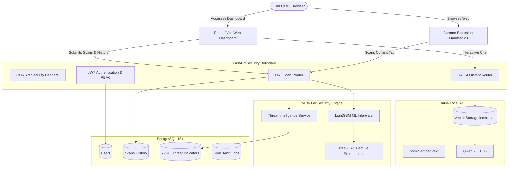

# PhishGuard X 🛡️

> **Next-Generation Intelligent Phishing Detection, Threat Intelligence & Cybersecurity Platform**

PhishGuard X is an enterprise-grade cybersecurity platform that combines high-performance Machine Learning, live Threat Intelligence feeds, offline Retrieval-Augmented Generation (RAG), a Chrome Manifest V3 browser extension, and a modern React/Vite dashboard to detect and neutralize phishing threats in real time.

---

## 🏛️ System Architecture



---

## 🚀 Key Features

1. **Hybrid Threat Detection**:
   - **Machine Learning**: LightGBM classifier evaluating 14 structural, lexical, and domain features with calibrated thresholds.
   - **Threat Intelligence**: Over 791,000 live indicators from Phishing.Database and URLhaus, matching exact URLs, SHA-256 hashes, and hostnames with provider attribution.
2. **Transparent Explainability**:
   - Computes exact TreeSHAP log-odds contributions for every scan factor (e.g. suspicious keywords, hyphens, subdirectories, Punycode).
3. **Strict RAG Security Boundary**:
   - RAG *never* determines whether a URL is malicious; detection is exclusively handled by ML and Threat Intelligence. RAG provides offline cybersecurity education and explains factors using local Ollama models (`nomic-embed-text` and `qwen2.5:1.5b`).
4. **Apex Domain Bias Mitigation**:
   - Non-destructive canonical host normalization in `url_features.py` neutralizes the PhiUSIIL 1-dot sampling artifact without retraining.
5. **Chrome Manifest V3 Extension**:
   - Real-time tab scanning, active badges (`SAFE`, `WARN`, `ALERT`), popup scanner radar, and full TreeSHAP explanations.
6. **Responsive React Web Dashboard**:
   - Interactive scanning interface, verdict telemetry cards, scan history with status tags, and embedded AI cybersecurity assistant.

---

## 📋 12-Phase Roadmap Status

| Phase | Description | Status | Test Coverage |
| :---: | :--- | :---: | :---: |
| **Phase 1** | Project Initialization & Environment Setup | ✅ COMPLETED | Verified |
| **Phase 2** | Database Schema, SQLAlchemy Models & Alembic Migrations | ✅ COMPLETED | Unit & DB Tests |
| **Phase 3** | Authentication, JWT, Password Security & Error Envelopes | ✅ COMPLETED | Unit & API Tests |
| **Phase 4** | URL Feature Extraction & PhiUSIIL Audit | ✅ COMPLETED | Feature Extraction Tests |
| **Phase 5** | Machine Learning Model Training, Selection & Evaluation | ✅ COMPLETED | LightGBM Artifact Audited |
| **Phase 6** | End-to-End URL Scanning Engine & TreeSHAP Explanations | ✅ COMPLETED | Scan Service Tests |
| **Phase 7** | Multi-Provider Threat Intelligence (Phishing.Database & URLhaus) | ✅ COMPLETED | Ingestion & Match Tests |
| **Phase 8** | Local RAG Cybersecurity Assistant & Deterministic Fallbacks | ✅ COMPLETED | Vector & Retrieval Tests |
| **Phase 9** | Chrome Extension Manifest V3 (Popup, Service Worker, Badges) | ✅ COMPLETED | Manifest & Lint Tests |
| **Phase 10** | React 18 / Vite Web Dashboard & Real-Time Telemetry | ✅ COMPLETED | Build & API Coverage Tests |
| **Phase 11** | Integration, CORS, Security Headers & False Positive Hardening | ✅ COMPLETED | Integration Security Tests |
| **Phase 12** | Docker & Cloud Deployment Phase | ⏸️ DEFERRED | Deferred per user instruction |

**Active Test Suite Verification**: **148 automated tests across 17 test files — 100% PASSING**.

---

## 🛠️ Local Quickstart (Windows 11 PowerShell)

### Prerequisites
- Python 3.12+ (in `backend\.venv`)
- Node.js v20+ and npm
- PostgreSQL 16+ running locally on port 5432 (database: `phishguard_db`)
- *(Optional)* Ollama running on `localhost:11434` with `nomic-embed-text` and `qwen2.5:1.5b`

### 1. Configure Environment
```powershell
Copy-Item .env.example .env
```
Edit `.env` to set your PostgreSQL credentials and JWT secret.

### 2. Backend Setup
```powershell
# Activate existing virtual environment
backend\.venv\Scripts\Activate.ps1

# Run database migrations
backend\.venv\Scripts\python.exe -m alembic upgrade head

# Start FastAPI backend
backend\.venv\Scripts\python.exe -m uvicorn backend.app.main:app --reload --port 8000
```
Backend API will be active at: `http://localhost:8000` (Interactive Swagger docs at `http://localhost:8000/docs`).

### 3. Frontend Setup
```powershell
cd frontend
npm install
npm run dev
```
Frontend Web Dashboard will be active at: `http://localhost:3000`.

### 4. Chrome Extension Installation
1. Open Google Chrome and navigate to `chrome://extensions/`.
2. Enable **Developer mode** toggle in the top-right corner.
3. Click **Load unpacked**.
4. Select the `browser-extension` folder inside this repository:
   `C:\Users\shubh\Desktop\PhishGuard_X\browser-extension`.
5. Pin **PhishGuard X** to your browser toolbar.

---

## 🧪 Running the Test Suite

Run all 148 automated tests across all active phases:

```powershell
backend\.venv\Scripts\python.exe -m pytest -v
```

---

## 📡 Threat Intelligence Synchronization

To synchronize fresh threat indicators from external feeds:

```powershell
# Synchronize both Phishing.Database and URLhaus feeds
backend\.venv\Scripts\python.exe -m backend.scripts.sync_threat_feeds
```

---

## 📖 API Reference Summary

| Method | Endpoint | Description | Auth Required |
| :--- | :--- | :--- | :---: |
| `GET` | `/api/v1/health` | Service liveness health check | No |
| `GET` | `/api/v1/health/ready` | Readiness check (database connectivity) | No |
| `POST` | `/api/v1/auth/register` | Register a new user account | No |
| `POST` | `/api/v1/auth/login` | Authenticate user & receive JWT token | No |
| `GET` | `/api/v1/auth/me` | Fetch authenticated user profile | Yes |
| `POST` | `/api/v1/scans/` | Scan a URL (ML + Threat Intel + SHAP) | Yes |
| `GET` | `/api/v1/scans/history` | Paginated user scan history | Yes |
| `POST` | `/api/v1/assistant/ask` | Ask general cybersecurity question to RAG | Yes |
| `POST` | `/api/v1/assistant/ask-scan/{id}` | Ask RAG assistant to explain specific scan | Yes |

---

## 📄 License & Attribution

- **PhishGuard X** is released under the MIT License.
- **Threat Feeds**:
  - [Phishing.Database](https://github.com/mitchellkrogza/Phishing.Database)
  - [abuse.ch URLhaus](https://urlhaus.abuse.ch/) (Verify current provider terms prior to commercial redistribution).
